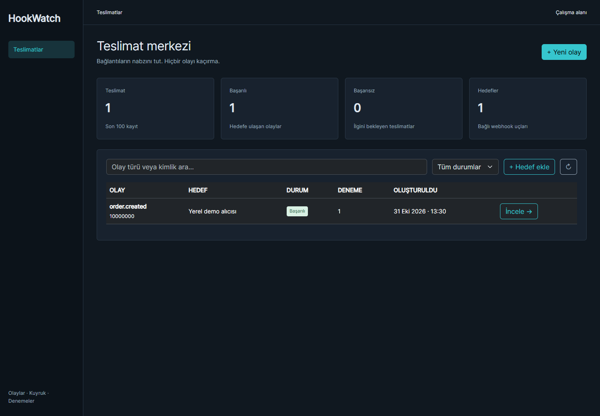

# HookWatch

Her olayın izini sür. Webhook gönderimleri için kalıcı kuyruk ve izleme paneli.

**Angular 22 + TypeScript · Java 17 · Spring Boot 3.5 · Spring Data JPA · Flyway · PostgreSQL 17**



[Telefon görünümü](docs/mobile.png)

## Arayüz

**NG Bootstrap + Bootstrap** · Koyu operasyon ekranı, camgöbeği vurgu ve teslimat/deneme kayıtları. Tema sınırları ve doğrulama notları: [Arayüz sistemi](docs/ui.md).

## Özellikler

- İzin verilen origin listesiyle hedef kaydı
- JSON olayları için PostgreSQL üzerinde kalıcı kuyruk
- Gerçek HTTP POST ve HMAC-SHA256 imzası
- SKIP LOCKED ile çoklu worker arasında tekil iş sahiplenme
- Ağ hatası, 408, 429 ve 5xx için 2/4/8 saniye aralıklarla tekrar (toplam dört deneme)
- Kalıcı hatalarda manuel yeniden deneme ve kalıcı deneme geçmişi

## Çalıştırma

Gereksinimler: Node.js 22.22.3+, Java 17+ (JAVA_HOME tanımlı), Docker Compose.

```sh
git clone https://github.com/hassanbera/hookwatch-spring.git
cd hookwatch-spring
docker compose up -d --wait
```

API için bir terminal:

```sh
cd backend
./mvnw spring-boot:run
```

Windows PowerShell üzerinde `./mvnw` yerine `.\mvnw.cmd` kullan.

Arayüz için ikinci terminal (repo kökünden):

```sh
cd frontend
npm ci
npm start
```

- Arayüz: http://localhost:5205
- API: http://127.0.0.1:4205/api
- Veritabanı: localhost:55505
- Sağlık: http://127.0.0.1:4205/api/health

API ilk açılışta sürümlenmiş Flyway migrationlarını uygular. İkinci migration yalnızca ilk kurulumda kurgusal demo verilerini ekler; sonraki açılışlarda mevcut kayıtlar korunur. `docker compose down` servisi durdurur ve verileri volume içinde korur.

## Mimari

```text
frontend/src/             Angular standalone bileşeni, tipler ve HTTP istemcisi
backend/src/main/java/dev/bera/app/
  model/                 Veri modelleri
  repository/            JPA ve PostgreSQL erişimi
  service/               İş kuralları ve transactionlar
  controller/            HTTP giriş / çıkış
  common/                Doğrulama ve hata yanıtları
database/                 Okunabilir sürümlenmiş SQL
tests/api.test.mjs         Gerçek HTTP + PostgreSQL testleri
scripts/test.mjs           İzole test veritabanı ve API süreç yönetimi
```

Controller → Service → Repository → JPA → PostgreSQL. Controller veritabanına erişmez. İlişkiler SQL içinde foreign key ve indekslerle, JPA içinde model eşlemeleriyle korunur. İş kuralları service katmanındadır.

## API

Başarılı yanıtlar `{"data": ...}`; iş kuralı hataları `{"error": "..."}` biçimindedir. Geçersiz girdi 400, eksik kayıt 404, çakışma 409 döndürür. Framework seviyesindeki bozuk istekler standart HTTP hata yanıtı kullanabilir.

| Yöntem | Yol |
| --- | --- |
| GET | /api/health |
| GET | /api/endpoints |
| POST | /api/endpoints |
| GET | /api/deliveries |
| POST | /api/deliveries |
| GET | /api/deliveries/{id} |
| POST | /api/deliveries/{id}/retry |

Örnek istek ve kritik senaryolar [tests/api.test.mjs](tests/api.test.mjs) içinde çalıştırılabilir biçimde bulunur.

## Doğrulama

Repo kökünde:

```sh
npm test
```

Test scripti kendi rastgele isimli veritabanını oluşturur, backend'i derler, ayrı bir portta başlatır ve HTTP testlerini çalıştırır. Sonunda yalnızca kendi oluşturduğu test veritabanını kaldırır. Geliştirme kayıtlarına dokunmaz. Docker çalışıyor olmalıdır. Sunucu çıktısı `test-results/server.log` dosyasına yazılır.

Üretim derlemeleri:

```sh
cd backend
./mvnw -q package
```

```sh
cd frontend
npm run build
```

## Yapılandırma

`DB_URL` (varsayılan `jdbc:postgresql://localhost:55505/hookwatch`), `DB_USER`, `DB_PASSWORD`, `PORT`, `HOST`. Yerel Compose hesabı `app`, parolası `local-development-only` değeridir; bunlar sadece yerel geliştirme içindir. Dağıtımda environment secret kullan.

Teslimat en az bir kez semantiğindedir. Worker, transaction boyunca satır kilidini tutar; HTTP sonrasında süreç çökerse PostgreSQL transactionı geri alır ve olay yeniden gönderilebilir. Alıcı X-HookWatch-Id ile tekrarları ayıklamalıdır. Her istek en fazla beş saniye sürer; redirect takip edilmez. Panel son 100 teslimatı gösterir.

WEBHOOK_ALLOWED_ORIGINS virgülle ayrılan tam origin listesidir. Varsayılan yalnızca bu API'nin yerel originidir. Yalnızca kontrol ettiğin hedefleri ekle; allowlist, DNS rebinding korumasının yerini tutmaz. WEBHOOK_SIGNING_SECRET üretimde güçlü bir secret olmalıdır. İmza X-HookWatch-Signature başlığında `sha256=<hex>` biçimindedir; HMAC-SHA256(secret, timestamp + "." + hamJSON) üzerinden hesaplanır. Alıcı imzayı sabit zamanlı karşılaştırmalı ve X-HookWatch-Timestamp için kabul edilebilir bir süre penceresi uygulamalıdır. WORKER_ENABLED=false worker'ı durdurur.

Bu sürüm tek çalışma alanlıdır; giriş ve kullanıcı bazında yetkilendirme içermez. API ve geliştirme arayüzü varsayılan olarak localhost üzerinde dinler. Üretim için kimlik doğrulama ve yetkilendirme ekle, Angular `frontend/dist/browser` çıktısını statik sun, aynı origin altındaki `/api` isteklerini backend'e yönlendir. Backend'in ağ dinleme adresini dağıtım ortamında açıkça yapılandır.

CI örneği [docs/ci.yml](docs/ci.yml) içinde bulunur. GitHub Actions workflow yazma yetkili bir oturumda `.github/workflows/ci.yml` yoluna taşıyarak etkinleştirilebilir.
